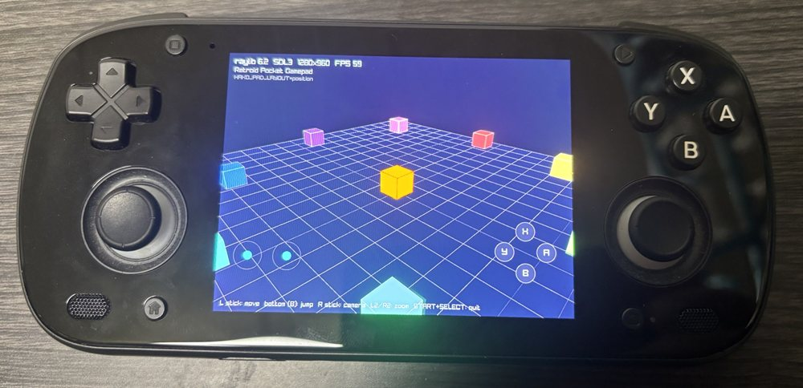
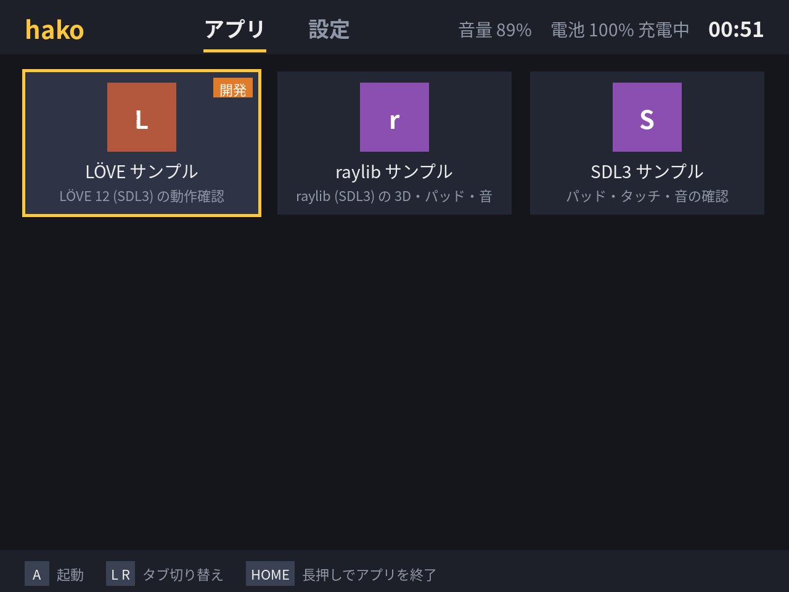
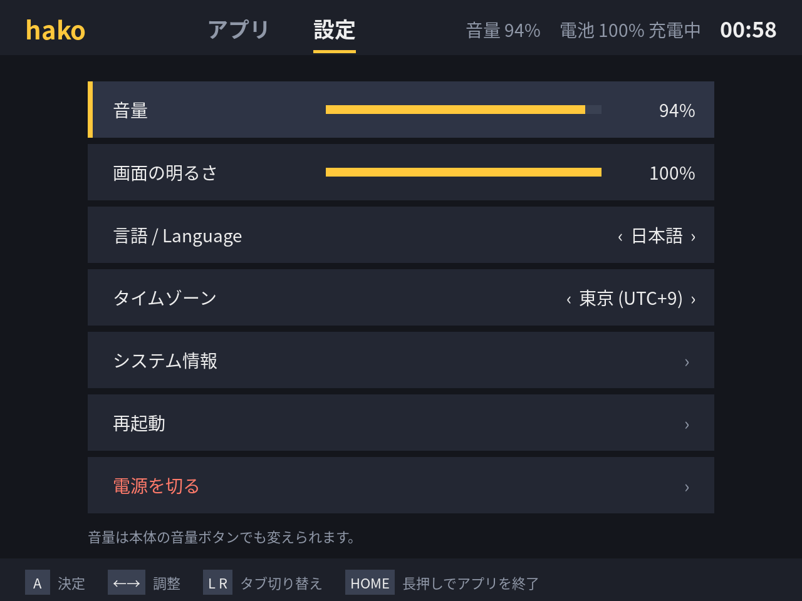
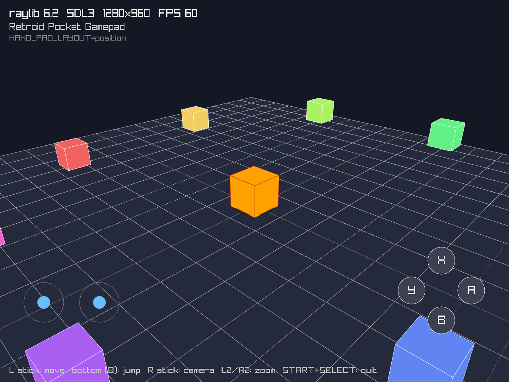

# hako-os

hako: a Debian trixie (arm64) based environment for game consoles with Qualcomm
SoCs booted by OpenABL, for deploying our own applications. Images are built with ELBE.
Every component is a .deb.



| launcher: apps | launcher: settings | raylib sample |
|---|---|---|
|  |  |  |

## Supported devices

| device | SoC | image | state | known issues |
|---|---|---|---|---|
| Retroid Pocket Mini (V1) | SM8250 (Snapdragon 865) | `rpmini-dev.img` | main target: display, touch, pad, audio, USB, Wi-Fi, Bluetooth, GPU, suspend | suspend is shallow (s2idle only); power off to keep the battery |
| Anbernic RG 55G1 | SM4450 (Snapdragon G1 Gen 2) | `rg55g1-dev.img` | display, touch, pad, speakers, USB, GPU (hako-mesa), clock | headphones do not take over from the speakers; fan always on; Wi-Fi connection not tried yet |

Setting up a device (backup and OpenABL over EDL from a Windows or Linux PC, then the image): [docs chapter 1](docs/en/1-device-setup.md).
How the RG 55G1 was brought up: [chapter 5](docs/en/5-example-rg55g1.md).

| dir | content |
|---|---|
| kernel/   | kernel build per SoC (SM8250, SM4450): pinned upstream + ROCKNIX patches/DTS, config fragments -> linux-image .deb |
| packages/ | own Debian packages (below) and board support (rpmini-bsp, rg55g1-bsp) |
| samples/  | samples run from /data/dev/apps without packaging (LÖVE) |
| repo/     | reprepro config; built .debs are published here (repo/dists, repo/pool are not tracked) |
| elbe/     | ELBE project XMLs (per board: rpmini-dev.xml, rg55g1-dev.xml) |
| scripts/  | build / deploy / flash helpers |
| tools/    | device setup: tools/edl/hako_edl.py (backup, OpenABL flash/restore over EDL; QPST on Windows, qdl on Linux), Android-side fallback scripts |
| docs/     | documentation (en / ja) |

## Packages

| package | role |
|---|---|
| hako-base, hako-session | first-boot data partition growing, clock kept on boards whose RTC cannot be set; the game session (cage kiosk compositor, user `hako`, PipeWire, volume keys) |
| hako-launcher | app launcher and system settings (volume, brightness, language, time zone, power), SDL3 |
| hako-dev | development image extras (ssh, debugging tools, apt over the USB link) |
| hako-sdl-hello | SDL3 sample / template |
| hako-love | LÖVE 12 (SDL3) from a pinned upstream snapshot |
| hako-raylib-hello | raylib (SDL3 platform) sample |
| hako-raylib-classics | the 12 classic games of raylib (raysan5/raylib-games) in one app, for pad and touch |
| hako-siv3d-games | the 22 game samples of Siv3D in one app, for pad and touch (SDL3 port of OpenSiv3D) |
| hako-mesa | Mesa 26.2 (freedreno, turnip) in /usr/lib/hako/mesa for GPUs Debian's Mesa does not know yet (Adreno 613) |
| rpmini-bsp | Retroid Pocket Mini board support: ESP/boot entry updates, USB gadget, UCM, pad mapping, panel rotation |
| rg55g1-bsp | Anbernic RG 55G1 board support: the same parts for that device, session on hako-mesa |

Apps are registered with small `.app` files (`/usr/share/hako/apps`, `/data/dev/apps`) and started from hako-launcher.

## Building

Build host: Debian trixie (x86_64; WSL2 works) with arm64 multiarch development packages and ELBE 15.9.

```sh
git submodule update --init
kernel/build.sh                         # kernel .deb -> out/kernel/ (once; needed by the image)
SOC=SM4450 kernel/build.sh              # the same for the RG 55G1
bash scripts/build-packages.sh          # changed packages -> out/packages/
bash scripts/build-image.sh dev         # dev image -> out/images/dev/rpmini-dev.img
BOARD=rg55g1 bash scripts/build-image.sh dev   # -> out/images/dev/rg55g1-dev.img
bash scripts/dev-update.sh <pkg>...     # update a device on the USB link (192.168.7.2)
```

Documentation: [English](docs/en/README.md) / [日本語](docs/ja/README.md)

1. preparing a device (backup and OpenABL over EDL, writing the image)
2. the daily development loop and the samples (SDL3, LÖVE, raylib, Siv3D, Kirikiri Z)
3. packaging an app and building an image with it
4. bringing up another OpenABL + Qualcomm handheld
5. worked example of 4: the Anbernic RG 55G1

## Working with an AI agent

The workflow is designed to be driven together with an AI coding agent: the agent builds, deploys,
reads logs and takes screenshots; the human handles the device and makes the irreversible decisions.
[AGENTS.md](AGENTS.md) (also read through CLAUDE.md) is the entry point for agents.

## Status

Experimental. Booting needs [OpenABL](https://github.com/OpenHandheldCollective/OpenABL) on the device, which replaces the stock
bootloader (ABL); back up the device-specific partitions before trying anything.

## License

hako-os itself is MIT licensed (see LICENSE). Third-party parts keep their own licenses:

- [Linux kernel](https://www.kernel.org/) and the [ROCKNIX](https://rocknix.org/) SM8250 / SM4450 patches/DTS it is built with
  (from [ROCKNIX/distribution](https://github.com/ROCKNIX/distribution), fetched at build time): GPL-2.0
- UCM configuration in rpmini-bsp and rg55g1-bsp (from ROCKNIX's patches to [alsa-ucm-conf](https://github.com/alsa-project/alsa-ucm-conf)): BSD-3-Clause
- [Mesa](https://mesa3d.org/) (hako-mesa, Debian's source tarball fetched at build time): MIT and others, see its docs
- [LÖVE](https://love2d.org/) (submodule, packages/hako-love/love): zlib license
- [raylib](https://www.raylib.com/) (submodule, packages/hako-raylib-hello/raylib): zlib license
- [raylib-games classics](https://github.com/raysan5/raylib-games) (packages/hako-raylib-classics/classics): zlib license;
  the notices of the third-party code built into raylib are in the app and in packages/hako-raylib-classics/licenses
- [OpenSiv3D](https://github.com/Siv3D/OpenSiv3D) (SDL3 port, fetched at build time) and its bundled fonts, in hako-siv3d-games: MIT and the
  licenses listed in the app; the games are based on the Siv3D documentation samples (MIT) and on
  [Siv3D-Samples](https://github.com/Siv3D/Siv3D-Samples) / [Reputeless/games](https://github.com/Reputeless/games) (CC0)
- Firmware listed in kernel/firmware-<SOC>.list (fetched at build time from
  [linux-firmware](https://git.kernel.org/pub/scm/linux/kernel/git/firmware/linux-firmware.git), and for SM4450 also from
  [ROCKNIX extra-firmware](https://github.com/ROCKNIX/extra-firmware)): see their license files
